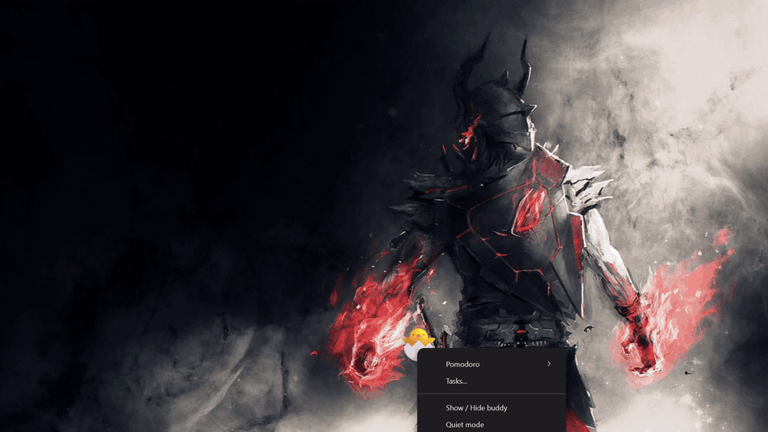

<p align="center">
  
</p>

<h1 align="center">Desktop Buddy</h1>

<p align="center">
  A small buddy that lives on your Windows desktop and reminds you when it is time to focus, take a break, or do a task.
</p>

> **Status: v0.1.0, first public preview.** Pomodoro and task reminders work today. Prayer times are the next feature; see the [roadmap](#roadmap).

## Demo



[Watch the full demo video](https://github.com/seiffawal/desktop-buddy/releases/download/v0.1.0/desktop-buddy-demo-2026-11-25.mp4).

## What it does

- **A buddy on your screen.** Small, transparent, always on top, draggable. It remembers where you left it and falls asleep when you are away.
- **Pomodoro.** Focus and break cycles with a long break after the last round. Presets for Classic (25/5), Long (50/10), and Short (15/3). The buddy changes mood, a countdown shows under it, and a soft chime marks each phase.
- **Task reminders.** Add a task for today, tomorrow, or every day. The buddy pops up with **Done** and **Snooze**. If the app was closed when a task came due, it tells you once when it starts.
- **Calm by design.** Quiet mode makes bubbles small and silent. Do-not-disturb holds everything back. Both are one click away in the tray menu.
- **Reliable timing.** Timers use real timestamps, so the countdown stays correct after sleep, and an unfinished Pomodoro is restored after a restart.
- **Private.** Everything is stored in one JSON file on your PC. The app makes no network connections and collects nothing.

## Install

1. Download **Desktop Buddy Setup x.y.z.exe** from the [Releases](https://github.com/seiffawal/desktop-buddy/releases) page.
2. Run it. Windows may show *Windows protected your PC* because the installer is not code-signed yet. Choose **More info**, then **Run anyway**.
3. Look for the buddy on your screen and the small chick in the system tray (it may be under the **^** arrow near the clock).

## Using it

Right-click the buddy, or right-click the tray icon, to open the menu.

| Menu item | What it does |
|---|---|
| Pomodoro | Start, pause, resume, skip, reset, and choose a preset |
| Tasks... | Open the task list and add reminders |
| Show / Hide buddy | Hide the buddy without quitting (left-click the tray icon does the same) |
| Quiet mode | Small, silent bubbles and a sleepy buddy |
| Do not disturb | Holds back all messages except prayer reminders (once they exist) |
| Sound / Snooze length | Volume, a test sound, and how long Snooze waits |
| Start with Windows | Launch with Windows (installed app only) |
| Open data folder | Opens the folder with your saved data |

Your data is in `%APPDATA%\desktop-buddy\buddy-data.json`. Delete that file to start fresh.

## Run from source

You need [Node.js](https://nodejs.org) (LTS) and Git.

```powershell
git clone https://github.com/seiffawal/desktop-buddy.git
cd desktop-buddy
npm install
npm start
```

When run from source, the tray menu also has *Preview animation*, *Test bubbles*, and a *Quick test* for Pomodoro, and the terminal prints the app's events. These extras are hidden in the installed app.

```powershell
npm test        # runs all the test suites
npm run dist    # builds the Windows installer into dist/
```

See [docs/RELEASING.md](docs/RELEASING.md) for the release steps.

## How it is built

Desktop Buddy is an [Electron](https://www.electronjs.org) app written in plain JavaScript, HTML, and CSS. It is organised so that new features plug in without changing the old ones.

```
src/
  main/        Electron main process: windows, tray, startup
  core/        message bus, universal message format, storage, bubble queue
  modules/
    pomodoro/  focus and break cycles
    tasks/     reminders
  renderer/    the buddy, speech bubble, countdown, sounds, and the tasks window
assets/        icon and character data
test/          tests for the queue, Pomodoro, and tasks
```

- **Modules never call each other.** They publish and subscribe to events on a small message bus (`prayer:started`, `pomodoro:state`, `buddy:message`, and so on).
- **One message format for every bubble.** A message has a sender, text, buttons, and a priority. The bubble only knows how to display that shape, so anything can talk through the buddy.
- **Characters are data.** A character is a small JSON file that maps moods to emoji and animations. See `assets/characters/chick/character.json`.
- **One storage layer.** Settings, tasks, and position all go through `src/core/storage.js`, which saves atomically.
- **Windows are locked down.** The renderer has no Node access, each window exposes only the functions it needs, and navigation and pop-ups are blocked.

## Roadmap

- [ ] Prayer times (Cairo and the Egyptian method by default), a bubble at each prayer, minute adjustments, and an optional adhan sound
- [ ] Prayer interrupts Pomodoro and resumes it afterwards
- [ ] A settings window
- [ ] Better art and more characters
- [ ] Family buddies: see who is online and send a wave
- [ ] An optional AI helper

The full list is in [docs/BACKLOG.md](docs/BACKLOG.md).

## Contributing

Issues and ideas are welcome. If you send a pull request, please run `npm test` first and keep the modules independent of each other.

## License

[MIT](LICENSE)
